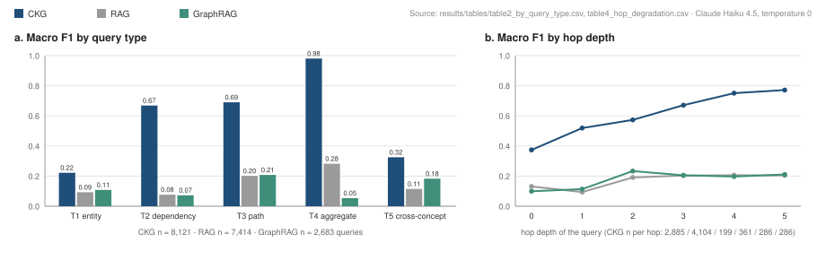
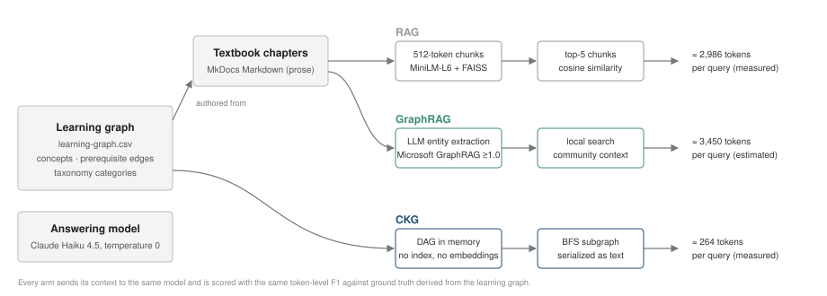

<p align="center">
  
</p>

# CKG Benchmark

**Benchmarking Knowledge Retrieval Architectures: RAG, GraphRAG, and Compact Knowledge Graphs**

Daniel Yarmoluk (Graphify.md) · Dan McCreary

[Paper (PDF)](paper/main.pdf) · [Paper (HTML)](paper/paper.html) · [Documentation site](https://yarmoluk.github.io/ckg-benchmark/) · [Dataset on Hugging Face](https://huggingface.co/datasets/danyarm/ckg-benchmark) · [Zenodo DOI 10.5281/zenodo.21222965](https://doi.org/10.5281/zenodo.21222965)

[](LICENSE)
[](https://creativecommons.org/licenses/by/4.0/)
[](paper/main.pdf)
[](https://doi.org/10.5281/zenodo.21222965)
[](https://huggingface.co/datasets/danyarm/ckg-benchmark)
[](https://huggingface.co/spaces/danyarm/krb-leaderboard)
[](https://yarmoluk.github.io/ckg-benchmark/)
[](evaluation/requirements.txt)

---

## 1. Research question

Retrieval-augmented generation (RAG) and graph-based retrieval (GraphRAG) both start from unstructured text and recover structure at query time, either by embedding similarity or by LLM entity extraction. This benchmark asks a narrower question:

> When a domain's knowledge already exists as an explicit dependency graph, how much answer quality and token efficiency is lost by discarding that structure and retrieving from prose instead?

A **Compact Knowledge Graph (CKG)** is the control condition: a directed acyclic graph (DAG) of concepts, prerequisite edges, and taxonomy labels, stored as a plain CSV and served to the model as a small text subgraph. No vector index, no embeddings, no extraction step.

**Central contribution.** A reproducible, three-arm comparison (CKG, RAG, GraphRAG) over 47 domains with deterministic ground truth derived from the graph itself, plus the metric suite and harnesses needed to rerun it. The benchmark is deliberately favourable to structured retrieval, and Section 7 states where that limits what the results can support.

## 2. Headline results

All three arms send their retrieved context to the same model (Claude Haiku 4.5, temperature 0) and are scored with the same SQuAD-style token F1 against the same ground truth. Numbers below are regenerated from the committed result files by `evaluation/analyze_results.py` (Section 6 shows this reproduces the tables byte-for-byte).

| System | Domains | Queries | Macro F1 | Tokens / query | RDS (F1 / tokens) | Cost / query (USD) |
|---|---:|---:|---:|---:|---:|---:|
| **CKG** | 47 | 8,121 | **0.493** | **264** | **2.16 × 10⁻³** | **0.00054** |
| RAG (FAISS, top-5) | 44 | 7,414 | 0.122 | 2,986 | 4.79 × 10⁻⁵ | 0.00354 |
| GraphRAG (local search) | 20 | 2,683 | 0.120 | 3,450 † | 4.52 × 10⁻⁵ | 0.00552 † |

Source: `results/tables/table1_macro_f1.csv`, `results/tables/table3_tokenomics.csv`. Cost uses uniform Claude Haiku 4.5 list pricing ($1.00 / $5.00 per million input / output tokens) derived from recorded token counts.
† GraphRAG's CLI does not expose per-query token usage; the harness records a fixed estimate of 3,450 tokens, so GraphRAG's RDS and cost are estimates rather than measurements.

Measured ratios on this benchmark, CKG relative to RAG: **4.0×** macro F1, **11.3×** fewer tokens per query, **45×** RDS, **6.6×** lower cost per query.

<p align="center">
  
</p>

**By query type** (`table2_by_query_type.csv`). CKG's advantage is concentrated in the structural query types it was designed for. Entity lookup (T1) is the weakest CKG result and acts as the negative control: a definition question gains little from a dependency graph.

| System | T1 entity | T2 dependency | T3 path | T4 aggregate | T5 cross-concept |
|---|---:|---:|---:|---:|---:|
| CKG | 0.222 | **0.668** | **0.690** | **0.980** | **0.325** |
| RAG | 0.093 | 0.077 | 0.201 | 0.282 | 0.115 |
| GraphRAG | 0.108 | 0.073 | 0.208 | 0.054 | 0.183 |

**By hop depth** (`table4_hop_degradation.csv`). CKG F1 rises with the length of the dependency chain the query requires; RAG and GraphRAG plateau near 0.2. Note the per-hop sample sizes: hops 2 to 5 together hold 1,132 of the 8,121 CKG queries, so the deep-hop estimates are noisier than the hop-0 and hop-1 estimates.

| System | hop 0 | hop 1 | hop 2 | hop 3 | hop 4 | hop 5 |
|---|---:|---:|---:|---:|---:|---:|
| CKG | 0.374 | 0.519 | 0.573 | 0.671 | 0.751 | 0.772 |
| RAG | 0.131 | 0.094 | 0.191 | 0.203 | 0.206 | 0.205 |
| GraphRAG | 0.100 | 0.114 | 0.233 | 0.205 | 0.197 | 0.211 |
| CKG queries at this depth | 2,885 | 4,104 | 199 | 361 | 286 | 286 |

**Track 2, pipeline-generated domain.** A GLP-1 / obesity pharmacology graph was assembled programmatically from the ClinicalTrials.gov API with no expert curation and run through all three arms (170 queries each). CKG macro F1 0.531, RAG 0.154, GraphRAG 0.144; CKG tokens per query 346. The single-domain result is consistent with Track 1 but is one domain, not a generalisation study.

**Structure Premium hypothesis, null result.** The paper hypothesised that CKG's RDS advantage would grow with DAG richness (edges per concept). Across the 46 Track 1 domains in `structure_premium.csv`, the Pearson correlation between DAG richness and CKG RDS is −0.10. The advantage is roughly uniform across graph densities rather than increasing with them.

## 3. The three architectures

<p align="center">
  
</p>

| | RAG | GraphRAG | CKG |
|---|---|---|---|
| Knowledge source | Textbook chapters (Markdown prose) | Textbook chapters (Markdown prose) | `learning-graph.csv` |
| Index | 512-token chunks, 50-token overlap, `all-MiniLM-L6-v2` embeddings, FAISS | Microsoft GraphRAG ≥ 1.0 entity graph (`text-embedding-3-small`) | None; DAG loaded in memory |
| Retrieval | Top-5 chunks by cosine similarity | Local search over extracted communities | BFS over prerequisite edges; subgraph serialised as `[TAXONOMY] Label \| prerequisites: …` |
| Answering model | Claude Haiku 4.5, T = 0 | Claude Haiku 4.5, T = 0 | Claude Haiku 4.5, T = 0 |
| Harness | `evaluation/rag_harness.py` | `evaluation/graphrag_harness.py` | `evaluation/ckg_harness.py` |

The prose corpus and the CSV are not independent: the McCreary textbooks were authored from their learning graphs, so RAG and GraphRAG are reconstructing structure that the CSV states directly. This is the intended comparison (what does recovering structure from text cost, relative to keeping it), and it is also a limitation (Section 7).

## 4. Benchmark design

### 4.1 Corpus

**Track 1, McCreary Intelligent Textbook Corpus.** Open-source educational textbooks published at [github.com/dmccreary](https://github.com/dmccreary). Each textbook ships a `learning-graph.csv` with an identical schema:

```csv
ConceptID,ConceptLabel,Dependencies,TaxonomyID
1,Function,,FOUND
2,Domain and Range,1,FOUND
4,Composite Function,1|3,FOUND
```

`Dependencies` is a pipe-delimited list of prerequisite `ConceptID`s; `TaxonomyID` is a domain-specific category label. Domains span STEM (calculus, genetics, circuits, quantum computing), professional (data science, blockchain, IT management), and foundational subjects (ethics, systems thinking, US geography).

**Track 2, pipeline-generated commercial domain.** One GLP-1 / obesity pharmacology graph built from the ClinicalTrials.gov API. Its CSV and query file are not distributed in this repository (see `.gitignore`); the per-query result records for all three arms are committed under `results/`.

**Released but not yet evaluated.** The repository also ships 20 NVIDIA developer-documentation graphs (`benchmark/domains/nvidia-*`) with generated queries. No results for these domains are included in the tables above.

| Released in this repository | Count |
|---|---:|
| Learning-graph CSVs (`benchmark/domains/*/learning-graph.csv`) | 73 |
| Concepts | 13,773 |
| Prerequisite edges | 21,837 |
| Query files (`benchmark/queries/*.jsonl`) | 68 |
| Queries | 11,434 |

Counts measured directly from the committed files on the current `main`. They differ from the figures in the paper and on Zenodo, which describe earlier snapshots (Section 7).

### 4.2 Query generation and ground truth

`evaluation/generate_queries.py` derives every query and its answer from the DAG with a fixed seed (42). There is no human annotation, so the ground truth is deterministic and inter-annotator agreement does not apply; it also means the ground truth is lexical and graph-shaped, which favours systems that can quote the graph.

| Type | Question | Ground truth | Queries released |
|---|---|---|---:|
| T1 entity | "What is *Composite Function*?" | Concept label and taxonomy code | 3,302 |
| T2 dependency | "What are the prerequisites for *X*?" | Labels of direct prerequisites | 3,130 |
| T3 path | "What is the prerequisite chain from *X* to *Y*?" | Labels along the path | 1,684 |
| T4 aggregate | "List all *FOUND* concepts" | All labels in the taxonomy group | 795 |
| T5 cross-concept | "How does *X* relate to *Y*?" | Labels on the connecting chain and shared neighbours | 2,523 |

Each query records a `hop_depth` (0 to 5) giving the length of the dependency chain it requires.

### 4.3 Metrics

| Metric | Definition | Where |
|---|---|---|
| Macro F1 | Mean over queries of SQuAD-style token F1 between the model's answer and the ground-truth labels | `evaluation/metrics.py`, `analyze_results.py` |
| Tokens per query | Mean of recorded prompt plus completion tokens (CKG, RAG measured; GraphRAG estimated) | `table3_tokenomics.csv` |
| RDS, Reasoning Density Score | Macro F1 divided by mean tokens per query | `metrics/metrics-spec.md` §2 |
| CUR, Context Utilisation Rate | Retrieved tokens divided by total tokens | `table1_macro_f1.csv` |
| CPCA, Cost per Correct Answer | Cost per query divided by F1 | `table1_macro_f1.csv` |
| Hop-depth F1 | Macro F1 stratified by `hop_depth` | `table4_hop_degradation.csv` |

The full specification of all 16 metrics, including those not reported in the headline tables, is in [`metrics/metrics-spec.md`](metrics/metrics-spec.md).

## 5. Repository layout

```
ckg-benchmark/
├── benchmark/
│   ├── domains/<domain>/learning-graph.csv   # 73 released graphs
│   ├── queries/queries_<domain>.jsonl        # 68 query sets, 11,434 queries
│   └── corpus-index.md                       # provenance of each source textbook
├── corpus/                                   # prose chapters for RAG/GraphRAG (gitignored; see §6)
├── evaluation/
│   ├── generate_queries.py                   # DAG -> queries + ground truth (seed 42)
│   ├── ckg_harness.py                        # CKG arm
│   ├── rag_harness.py                        # RAG arm (FAISS + MiniLM)
│   ├── graphrag_harness.py                   # GraphRAG arm (Microsoft GraphRAG CLI)
│   ├── fullcontext_harness.py                # no-retrieval control (not executed; see §7)
│   ├── metrics.py                            # metric implementations
│   ├── analyze_results.py                    # regenerates results/tables and figure data
│   └── krb_eval.py                           # plug-in harness for the public leaderboard
├── results/
│   ├── ckg/ rag/ graphrag/                   # one JSONL per domain, one record per query
│   ├── tables/                               # Tables 1-4, structure_premium.csv, cost reconciliation
│   └── figures/data/                         # JSON behind the paper figures
├── examples/ckg_contexts/                    # the exact CKG context sent to the model, per query type
├── metrics/                                  # metric spec and token-cost accounting
├── paper/                                    # LaTeX source, main.pdf, paper.html, figure scripts
├── docs/                                     # MkDocs site (yarmoluk.github.io/ckg-benchmark)
└── assets/readme/                            # SVG figures used in this README + generator script
```

## 6. Reproduction

### 6.1 Regenerate the tables from committed results (no API calls)

```bash
git clone https://github.com/Yarmoluk/ckg-benchmark
cd ckg-benchmark
python evaluation/analyze_results.py --systems ckg rag graphrag
```

This rewrites `results/tables/table1_macro_f1.csv` through `table4_hop_degradation.csv` from the per-query JSONL records. On the current `main` the regenerated Tables 1 to 4 are byte-identical to the committed files (verified 2026-10-14). `structure_premium.csv` differs in one cell when the undistributed Track 2 CSV is absent (its DAG richness falls back to 0).

### 6.2 Rerun an arm

```bash
pip install -r evaluation/requirements.txt
export ANTHROPIC_API_KEY=...

# CKG: needs only the CSV and the query file
python evaluation/ckg_harness.py --domain calculus
python evaluation/ckg_harness.py --all --parallel

# RAG: needs the prose corpus. Clone the source textbooks first (requires the gh CLI).
bash extract_corpus.sh
python evaluation/rag_harness.py --domain calculus

# GraphRAG: additionally needs OPENAI_API_KEY for text-embedding-3-small and the graphrag CLI
python evaluation/graphrag_harness.py --domain calculus --method local
```

Every harness supports `--dry-run` to exercise retrieval without model calls, and `--limit N` to cap queries per domain. Random seed 42 and temperature 0 are fixed in code.

### 6.3 Regenerate queries for a domain

```bash
python evaluation/generate_queries.py \
  --csv benchmark/domains/calculus/learning-graph.csv \
  --domain calculus \
  --output benchmark/queries/queries_calculus.jsonl
```

### 6.4 Evaluate your own retriever

`evaluation/krb_eval.py` wraps any retriever that returns a context string for a (domain, query) pair and emits a submission file for the [KRB leaderboard](https://huggingface.co/spaces/danyarm/krb-leaderboard). See the module docstring for the `Retriever` interface.

## 7. Limitations and open issues

These are stated so that the results are read at the right strength. Several are documented in more detail inside the repository and are flagged here rather than hidden.

1. **CKG retrieval reads query annotations that overlap with the answer key.** `generate_queries.py` writes `concept_id`, `path_ids`, and `taxonomy_id` into each query record alongside `ground_truth`, and the default `retrieve()` in `ckg_harness.py` resolves the subgraph from those fields. For T3 and T4 the retrieved set is therefore the ground-truth set. A text-only path (`retrieve_honest()`, which resolves concepts from the query string the way the shipped MCP server does) exists in the harness behind the `HONEST_RETRIEVAL` constant, which defaults to `False` and is not yet exposed as a command-line flag. A zero-LLM audit over 11,264 queries found answer coverage of 0.999 under the default path versus 0.994 under the text-only path, with the gap widening at hop 5 (1.000 → 0.925). The committed results were produced under the default path. Rerunning the published tables under the text-only path is the most important open item.
2. **The prose corpus was authored from the graphs being evaluated.** RAG and GraphRAG are asked to recover structure that the CKG receives verbatim. The benchmark measures the cost of that recovery; it does not measure how CKG performs when no curated graph exists.
3. **Ground truth is lexical and derived from the DAG.** Token F1 against concept labels rewards answers that quote the graph. A correct paraphrase scores lower than a verbatim label; T1 scores are depressed for all arms partly because the ground truth includes the taxonomy code.
4. **GraphRAG token counts are estimates.** The harness records a fixed 3,450 tokens per query because the GraphRAG CLI does not report usage. GraphRAG RDS and cost should be read as approximate. GraphRAG also covers 20 domains, with several only partially run (for example `functions`, 10 queries; `ethics-course`, 21).
5. **One RAG domain is effectively missing.** `results/rag/rag_calculus.jsonl` contains 3 records with zero tokens, so RAG's calculus row contributes nothing meaningful; RAG is complete on 43 of its 44 listed domains.
6. **The no-retrieval control was not executed.** `evaluation/fullcontext_harness.py` implements the "put the whole corpus in the context window" control that the repository's own docstring argues every retrieval benchmark should report. `results/fullcontext/` contains only `--dry-run` cost estimates (`predicted_answer: "[DRY RUN]"`, F1 = 0) and must not be read as a measured baseline.
7. **Single model, single run, no confidence intervals.** All arms use Claude Haiku 4.5 at temperature 0 and each query was run once. Differences between arms are large relative to plausible run-to-run variance, but no variance was measured.
8. **The paper, Zenodo record, and repository describe different snapshots.** The v0.6.2 paper reports the locked run (CKG 44 domains, 7,758 queries, macro F1 0.4709; RAG 0.1231; GraphRAG 0.1200; 269 vs 2,982 tokens; RDS ratio 42×). The committed artifacts are a superset (47 domains, 8,121 queries, F1 0.4926; RDS ratio 45×) and the locked-run result files are no longer reproducible from the repository. The Zenodo description cites 65 domains and 11,031 queries, which matches neither. This README reports the repository artifacts because they can be regenerated.
9. **The paper's cost figures used inconsistent pricing.** The v0.6.2 paper reports run costs of $7.81 (CKG) versus $76.23 (RAG). As documented in [`results/tables/RECONCILIATION-v0.6.3.md`](results/tables/RECONCILIATION-v0.6.3.md), the RAG and GraphRAG harnesses priced the same model at Sonnet rates while the CKG harness used Haiku rates, a 3.75× asymmetry favouring CKG. `analyze_results.py` now derives cost from recorded token counts at uniform Haiku 4.5 pricing; the corrected totals are $4.39 (CKG), $26.26 (RAG), $14.81 (GraphRAG, estimated). The token ratio (11×) is a measurement and is unaffected. The paper text has not yet been updated.
10. **"Every answer traces to a declared edge" is a property of the context, not of the answer.** CKG makes the retrieved relationships inspectable; it does not prevent the model from answering incorrectly, and the benchmark reports answer quality only through macro F1. No hallucination rate is measured, and none should be inferred from the design.

Exploratory material in the repository that is **not** part of the headline results: small open-weight model runs under `results/small_model/` (Qwen3-8B and Phi-4-mini via Ollama, 10 to 28 queries each), the ClinicalTrials cost projection in `results/track3/` (projections, no long-context run executed), and the agent A/B transcripts under `demo/`.

## 8. Paper

Yarmoluk, D. and McCreary, D. *Benchmarking Knowledge Retrieval Architectures Across Educational and Commercial Domains: RAG, GraphRAG, and Compact Knowledge Graphs.* Version 0.6.2, 2026. Pre-print; arXiv submission pending.

| Format | Location |
|---|---|
| PDF | [`paper/main.pdf`](paper/main.pdf) |
| HTML | [`paper/paper.html`](paper/paper.html) (mobile layout: [`paper/read-on-phone.html`](paper/read-on-phone.html)) |
| LaTeX source | [`paper/main.tex`](paper/main.tex), sections in [`paper/sections/`](paper/sections/) |
| Figure scripts | [`paper/figures/`](paper/figures/) |
| Archived record | [doi:10.5281/zenodo.21222965](https://doi.org/10.5281/zenodo.21222965) |

The paper's version number lives in exactly one place, the `\paperversion` macro in `paper/main.tex`, and follows semantic versioning (see `CLAUDE.md`).

## 9. Citation

```bibtex
@misc{yarmoluk2026ckg,
  title   = {Benchmarking Knowledge Retrieval Architectures Across Educational
             and Commercial Domains: {RAG}, {GraphRAG}, and Compact Knowledge Graphs},
  author  = {Yarmoluk, Daniel and McCreary, Dan},
  year    = {2026},
  version = {0.6.2},
  doi     = {10.5281/zenodo.21222965},
  url     = {https://github.com/Yarmoluk/ckg-benchmark},
  note    = {Pre-print. Benchmark data CC BY 4.0, code MIT.}
}
```

If you use the source learning graphs, please also credit the [McCreary Intelligent Textbooks](https://github.com/dmccreary) project.

## 10. License

- **Code** (`evaluation/`, `src/`, `assets/`, scripts): [MIT](LICENSE), © 2026 Daniel Yarmoluk and Dan McCreary.
- **Benchmark data** (`benchmark/`, `results/`): [CC BY 4.0](https://creativecommons.org/licenses/by/4.0/).
- **Source learning graphs**: MIT, from the individual [dmccreary](https://github.com/dmccreary) textbook repositories listed in [`benchmark/corpus-index.md`](benchmark/corpus-index.md).

## Authors

- **Daniel Yarmoluk**, [Graphify.md](https://graphifymd.com). CKG architecture, benchmark design, Track 2 pipeline, RDS metric.
- **Dan McCreary**, [Intelligent Textbooks](https://github.com/dmccreary). Source corpus and learning-graph methodology.

Questions and reproduction reports: open an issue in this repository.
