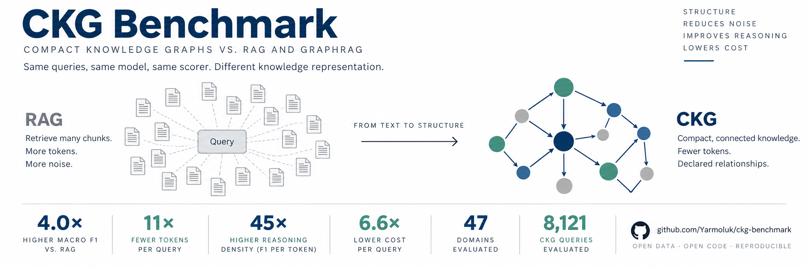

# CKG Benchmark



**Benchmarking Knowledge Retrieval Architectures: RAG, GraphRAG, and Compact Knowledge Graphs**

Daniel Yarmoluk (Graphify.md) · Dan McCreary

[](license.md)
[](https://creativecommons.org/licenses/by/4.0/)
[](https://github.com/Yarmoluk/ckg-benchmark/blob/main/paper/main.pdf)
[](https://doi.org/10.5281/zenodo.21222965)
[](https://huggingface.co/datasets/danyarm/ckg-benchmark)
[](https://huggingface.co/spaces/danyarm/krb-leaderboard)
[](https://github.com/Yarmoluk/ckg-benchmark)

## Research question

Retrieval-augmented generation (RAG) and graph-based retrieval (GraphRAG) both start from unstructured text and recover structure at query time. This benchmark asks a narrower question:

!!! quote
    When a domain's knowledge already exists as an explicit dependency graph, how much answer quality and token efficiency is lost by discarding that structure and retrieving from prose instead?

A **Compact Knowledge Graph (CKG)** is the control condition: a directed acyclic graph of concepts, prerequisite edges, and taxonomy labels, stored as a plain CSV and served to the model as a small text subgraph. No vector index, no embeddings, no extraction step.

## Headline results

All three arms send their retrieved context to the same model (Claude Haiku 4.5, temperature 0) and are scored with the same token-level F1 against the same ground truth. Numbers are regenerated from the committed result files by `evaluation/analyze_results.py`.

| System | Domains | Queries | Macro F1 | Tokens / query | RDS (F1 / tokens) | Cost / query (USD) |
|---|---:|---:|---:|---:|---:|---:|
| **CKG** | 47 | 8,121 | **0.493** | **264** | **2.16 × 10⁻³** | **0.00054** |
| RAG (FAISS, top-5) | 44 | 7,414 | 0.122 | 2,986 | 4.79 × 10⁻⁵ | 0.00354 |
| GraphRAG (local search) | 20 | 2,683 | 0.120 | 3,450 † | 4.52 × 10⁻⁵ | 0.00552 † |

† GraphRAG's CLI does not expose per-query token usage; the harness records a fixed estimate of 3,450 tokens.

CKG relative to RAG on this benchmark: **4.0×** macro F1, **11.3×** fewer tokens per query, **45×** RDS, **6.6×** lower cost per query.


| System | T1 entity | T2 dependency | T3 path | T4 aggregate | T5 cross-concept |
|---|---:|---:|---:|---:|---:|
| CKG | 0.222 | **0.668** | **0.690** | **0.980** | **0.325** |
| RAG | 0.093 | 0.077 | 0.201 | 0.282 | 0.115 |
| GraphRAG | 0.108 | 0.073 | 0.208 | 0.054 | 0.183 |

| System | hop 0 | hop 1 | hop 2 | hop 3 | hop 4 | hop 5 |
|---|---:|---:|---:|---:|---:|---:|
| CKG | 0.374 | 0.519 | 0.573 | 0.671 | 0.751 | 0.772 |
| RAG | 0.131 | 0.094 | 0.191 | 0.203 | 0.206 | 0.205 |
| GraphRAG | 0.100 | 0.114 | 0.233 | 0.205 | 0.197 | 0.211 |
| CKG queries at this depth | 2,885 | 4,104 | 199 | 361 | 286 | 286 |

## The three architectures


| | RAG | GraphRAG | CKG |
|---|---|---|---|
| Knowledge source | Textbook chapters (prose) | Textbook chapters (prose) | `learning-graph.csv` |
| Index | 512-token chunks, MiniLM-L6 embeddings, FAISS | Microsoft GraphRAG ≥ 1.0 entity graph | None; DAG in memory |
| Retrieval | Top-5 chunks by cosine similarity | Local search over communities | BFS over prerequisite edges |
| Answering model | Claude Haiku 4.5, T = 0 | Claude Haiku 4.5, T = 0 | Claude Haiku 4.5, T = 0 |

The prose corpus and the CSV are not independent: the McCreary textbooks were authored from their learning graphs, so RAG and GraphRAG are reconstructing structure that the CSV states directly. That is the intended comparison, and it is also a limitation.

## Released data

| In the repository | Count |
|---|---:|
| Learning-graph CSVs | 73 |
| Concepts | 13,773 |
| Prerequisite edges | 21,837 |
| Query files | 68 |
| Queries (T1 3,302 · T2 3,130 · T3 1,684 · T4 795 · T5 2,523) | 11,434 |

Ground truth is derived deterministically from the DAG by `evaluation/generate_queries.py` (seed 42); there is no human annotation. See [Query Types](benchmark/query-types.md) and the [Metrics Specification](metrics/metrics-spec.md).

## Limitations

The full list is in the repository README, section 7. The ones that most affect interpretation:

- The default CKG retrieval path reads `concept_id`, `path_ids`, and `taxonomy_id` annotations written into each query record; a text-only path exists in the harness but the published tables were not produced under it.
- The prose corpus was authored from the graphs being evaluated.
- GraphRAG token counts are a fixed estimate; one RAG domain (calculus) has only 3 zero-token records; the no-retrieval control harness was run in dry-run mode only.
- The v0.6.2 paper reports an earlier locked run (44 domains, 7,758 queries, F1 0.4709) and cost figures priced with inconsistent constants; see `results/tables/RECONCILIATION-v0.6.3.md`.
- Single model, single run, no confidence intervals.

## Navigate

- [Paper](paper/abstract.md) · [Results](paper/results.md) · [Discussion](paper/discussion.md)
- [Benchmark overview](benchmark/index.md) · [Corpus index](benchmark/corpus-index.md) · [Domains](benchmark/domains.md)
- [Getting started](getting-started.md) · [Submit your system](submit.md)
- [GitHub repository](https://github.com/Yarmoluk/ckg-benchmark) · [Zenodo record](https://doi.org/10.5281/zenodo.21222965)

## Citation

```bibtex
@misc{yarmoluk2026ckg,
  title   = {Benchmarking Knowledge Retrieval Architectures Across Educational
             and Commercial Domains: {RAG}, {GraphRAG}, and Compact Knowledge Graphs},
  author  = {Yarmoluk, Daniel and McCreary, Dan},
  year    = {2026},
  version = {0.6.2},
  doi     = {10.5281/zenodo.21222965},
  url     = {https://github.com/Yarmoluk/ckg-benchmark}
}
```
